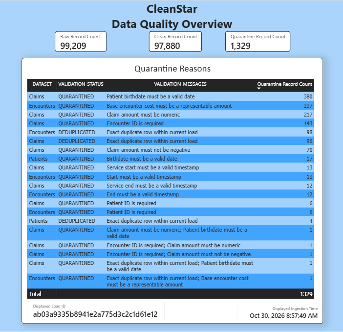
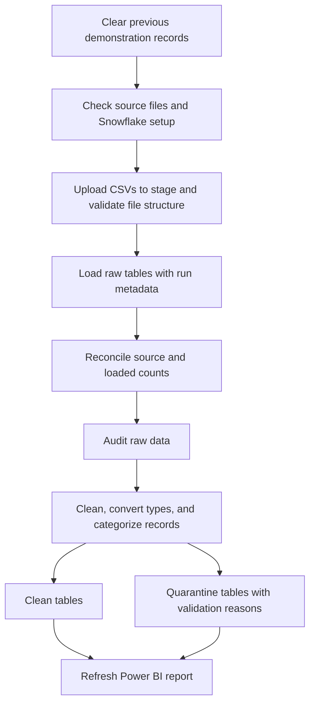
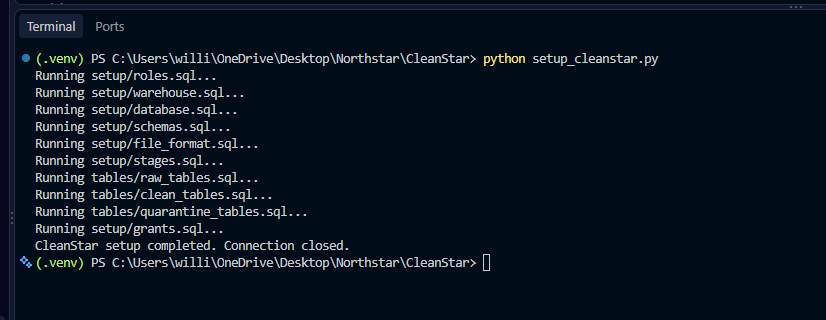
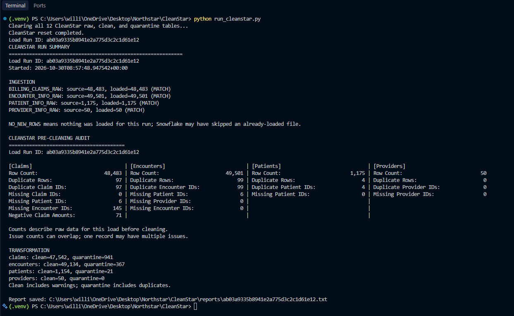

# CleanStar

A Python and Snowflake data pipeline that validates synthetic healthcare data,
separates accepted records from quarantined records, and presents the results
in Power BI.

CleanStar processes claims, encounters, patients, and providers from local CSV
files. It preserves source values in raw tables, applies cleaning and validation
rules in SQL, and records why each quarantined record could not be accepted.

I built CleanStar as a more clearly organized version of my Northstar project.
Python coordinates the workflow; SQL stays in separate files so the database
operations and business rules are easy to find, review, and explain.

**Technologies:** Python · SQL · Snowflake · Power BI

## Results

The reset, ingestion, transformation, and Power BI refresh workflow has been
verified against a live Snowflake account using the supplied synthetic data.

| Dataset | Raw records | Clean records | Quarantine records |
| --- | ---: | ---: | ---: |
| Claims | 48,483 | 47,542 | 941 |
| Encounters | 49,501 | 49,134 | 367 |
| Patients | 1,175 | 1,154 | 21 |
| Providers | 50 | 50 | 0 |
| **Total** | **99,209** | **97,880** | **1,329** |

Clean counts include records accepted with warnings. Quarantine counts include
rejected records and duplicates. Every source record is accounted for:
**97,880 + 1,329 = 99,209**.

## Dashboard

[Download the Power BI report](dashboard/CleanStar.pbix) and open it in Power BI
Desktop to explore the saved results. On GitHub, use **Download raw file** on
the file page to download the `.pbix`.



The report shows raw, clean, and quarantine totals, grouped quarantine reasons,
and the ingestion timestamp and load ID. A row with several validation messages
represents records failing that combination of rules; those records are counted
once in that group.

Ingestion timestamps are shown in **UTC**.

The screenshot is a saved demonstration snapshot. Later successful runs using
the same files produce the same counts with a new load ID and timestamp.

## Pipeline workflow



- **Raw:** source fields are loaded as VARCHAR, with load ID, filename, and ingestion timestamp.
- **Audit:** summarize issues before cleaning, including missing identifiers and duplicates.
- **Transformation:** normalize values, attempt type conversions, and apply dataset-specific rules.
- **Clean:** store accepted records with appropriate date, timestamp, and numeric column types.
- **Quarantine:** preserve original source values alongside validation status, rule IDs, and messages.
- **Reporting:** print and save a run summary, then manually refresh Power BI from Snowflake.

Invalid calendar dates are quarantined rather than corrected by guessing. The
rules distinguish duplicates, rejected records, warnings, and clean records.
See the [rule catalog](src/cleanstar/validation_rule_catalog.py) and
[transformation SQL](sql/transformations/) for the implementation.

## Demonstration data and reset design

**CleanStar is a portfolio demonstration using a fixed set of synthetic data in
local CSV files. Each run clears the previous table records so the same inputs
can demonstrate ingestion, validation, and transformation from a fresh state.**

Without this reset, repeatedly loading the same demonstration files would cause
previously accepted records to be classified as duplicates and accumulate in
quarantine. Resetting keeps the report focused on one complete demonstration
run. Duplicate records within the source files are still detected and reported.
The reset is an intentional demonstration convenience, not a requirement caused
by CSV files or synthetic data.

**This is not the default design we would use for an ongoing production pipeline.**
A production design would choose its load strategy based on source and business
requirements: typically retain raw history and run audit records, ingest new or
changed data incrementally, and handle retries without creating duplicate
results (idempotence). Updates might use merges, while already-processed inputs
could be skipped. A full refresh can also be appropriate for some datasets, but
would require an explicit replacement and recovery strategy rather than clearing
all raw, clean, and quarantine history before every run.

CleanStar's current database tables retain only the latest attempted run; a
failed reset or load can leave empty or partially populated tables. Saved text
reports remain on disk, but are not a substitute for retained source and audit
history. This tradeoff keeps the portfolio demonstration simple and repeatable.

## Run it yourself

### Prerequisites

- Python and the packages in [requirements.txt](requirements.txt).
- Your own Snowflake account and credentials. Setup and the automatic reset
  require a user that can activate SECURITYADMIN and SYSADMIN.
- Power BI Desktop if you want to build or refresh the interactive report.
  It is not required to run the Python pipeline.

Use a dedicated demonstration environment: each run clears the 12 CleanStar
pipeline tables. Credentials belong in your local `.env`, which is excluded
from Git; do not commit that file.

### 1. Prepare the Python environment

Open a terminal in the `CleanStar` directory. For Windows PowerShell:

```powershell
python -m venv .venv
.\.venv\Scripts\Activate.ps1
python -m pip install -r requirements.txt
```

### 2. Configure Snowflake

Copy [.env.example](.env.example) to `.env` if you do not already have one.
Replace the account, username, and password placeholders with your own values,
and set:

```dotenv
SNOWFLAKE_ROLE=CLEANSTAR_ROLE
SNOWFLAKE_WAREHOUSE=CLEANSTAR_WH
SNOWFLAKE_DATABASE=CLEANSTAR
SNOWFLAKE_SCHEMA=RAW
```

The SQL scripts target these CleanStar object names. Changing environment
variables alone does not rename the objects referenced in SQL.

### 3. Check the input files

The [data](data/) directory contains the four synthetic source files:

- `billing_claims_dirty.csv`
- `encounter_info_dirty.csv`
- `patient_info_dirty.csv`
- `provider_info_dirty.csv`

File and column mappings are defined in
[data_config.py](src/cleanstar/data_config.py).

### 4. Provision Snowflake objects

```powershell
python setup_cleanstar.py
```

Run setup separately before the first pipeline run. It creates the role,
warehouse, database, schemas, file format, stage, tables, and grants. It also
grants CLEANSTAR_ROLE to the setup user. Setup uses `IF NOT EXISTS`; rerunning
it does not migrate existing table definitions or change existing settings.



### 5. Run the pipeline

```powershell
python run_cleanstar.py
```

The first step clears all 12 raw, clean, and quarantine tables using a separate
administrative connection. A reset failure stops the pipeline. The remaining
workflow uses the configured pipeline role. Setup is not rerun.

The terminal displays the load ID, reconciliation results, raw audit, and
transformation counts. A text summary is saved to `reports/<load_run_id>.txt`.
Run only one pipeline at a time.



To clear records without starting ingestion:

```powershell
python reset_cleanstar.py
```

The reset preserves table definitions, grants, staged files, local CSVs, and
saved reports. It clears table load metadata so the same source files can load
again.

## Power BI connection and refresh

The report uses **Import** mode with Snowflake. Its three combined queries are
`Raw Records`, `Clean Records`, and `Quarantine Records`; each combines the four
corresponding dataset tables and adds a `DATASET` label.

To connect a report to your own environment, use the Snowflake connector with
your account's server address, warehouse `CLEANSTAR_WH`, database `CLEANSTAR`,
and role `CLEANSTAR_ROLE`.

After a successful pipeline run:

1. Open the report in Power BI Desktop.
2. Select **Home → Refresh → Data**.
3. Confirm its load ID matches the terminal report and that clean plus quarantine
   counts equal the raw count.
4. Save the refreshed report.


A saved Import-mode report can be viewed without Snowflake access; refreshing
requires credentials and an available Snowflake account. The saved report is available at
[dashboard/CleanStar.pbix](dashboard/CleanStar.pbix).

## Project layout

| Location | Purpose |
| --- | --- |
| `run_cleanstar.py` | Start the pipeline and save its summary |
| `setup_cleanstar.py` | Provision Snowflake objects separately |
| `reset_cleanstar.py` | Clear demonstration records without ingestion |
| `src/cleanstar/` | Python configuration, connections, orchestration, audit, and transformations |
| `sql/setup/` | Roles, warehouse, database, schemas, stage, file format, and grants |
| `sql/tables/` | Raw, clean, and quarantine table definitions |
| `sql/ingestion/` | Upload and raw-loading statements |
| `sql/validation/` | Setup checks, staged-file checks, reconciliation, and raw audits |
| `sql/transformations/` | Preparation, categorization, and destination inserts |
| `sql/reset_cleanstar.sql` | Clear all 12 demonstration tables |
| `data/` | Synthetic source CSVs |
| `reports/` | Saved pipeline summaries |
| `tests/` | Offline tests using simulated connections and cursors |
| `dashboard/CleanStar.pbix` | Power BI report with imported demonstration results |
| `screenshots/` | Setup, pipeline-run, and dashboard screenshots |
| `notes/` | Development notes and learning references |

## Verification and limitations

Run the offline tests from the CleanStar directory:

```powershell
python -B -m unittest discover -s tests -v
```

Tests cover sequencing, connection error handling, transaction handling, reports,
and cleanup. They also verify that reset happens first and a reset failure
prevents ingestion. Mocked tests complement the live run; they do not replace
Snowflake integration testing.

This project demonstrates a complete batch workflow, with deliberate limits:

- Reset and ingestion are not one transaction. A failed run can leave empty or
  partially populated tables; prior data is not restored.
- Clean and quarantine inserts commit together per dataset. Raw loads and earlier
  completed datasets can remain after a later failure.
- Connection setup retries selected transient failures, but the pipeline has no
  automatic workflow resume or retry. Inspect failures before starting another
  run, which will clear the tables again.
- Shared stage filenames and resets make concurrent pipeline runs unsupported.
- Setup validation checks object access and column names, not every column type
  or file-format property.
- The summary reports insert counts and the pre-cleaning audit; it is not a
  separate post-cleaning audit of every business rule.

